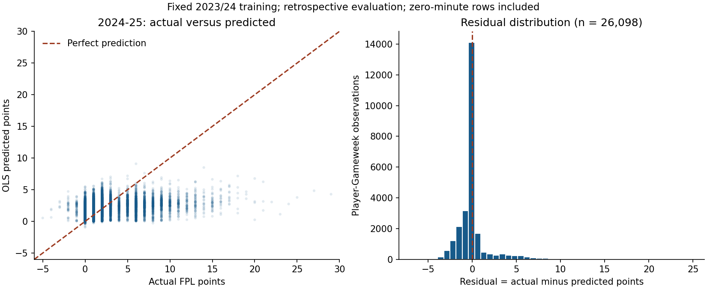
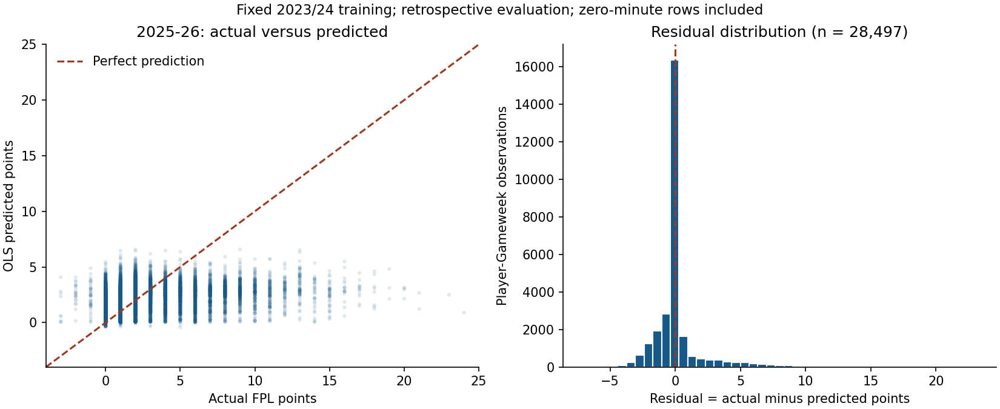

# Educational OLS historical backtest

This is a standalone learning experiment, with no website integration.

Protocol: `educational-ols-v1`; SHA-256 `1ba4d4c991816d2650d51b4f68c02bd506a614f377f2720a7ef3c69b59f85afd`.

## Chronology and evaluation status

Fit once on 2023/24, then predict every eligible 2024/25 and 2025/26 player-Gameweek. Coefficients are frozen throughout both evaluation seasons; only pre-deadline player history updates.
Training rows: **27,877**. Evaluation rows: **54,595**. Training labels excluded because they were unavailable before evaluation: 0.

The feature list, three-GW window and examples were fixed before the first OLS fit. No regularisation, hyperparameter search, feature selection, outcome-based example selection, prediction clipping, weighting or evaluation-season refitting is used. Development is a separate command/output folder.

**Neither 2024/25 nor 2025/26 is an untouched final holdout:** both were evaluated in earlier repository experiments. 2024/25 is the requested held-out-from-fitting validation; 2025/26 is an additional retrospective comparison. These results are not used to revise this model. A future untouched evaluation must be predeclared separately before its outcomes are inspected.

## Accuracy

Lower MAE/RMSE is better; higher R² is better. MAE is the average absolute points error. RMSE squares errors before averaging, so big misses matter more. R² compares squared error against predicting the evaluation sample's mean: 1 is perfect, 0 matches that reference, and a negative value is worse. It is not an accuracy percentage. Pooled scores weight every player-GW equally, rather than averaging Gameweek metrics.

| Season | Model | Observations | MAE | RMSE | R² |
| --- | --- | ---: | ---: | ---: | ---: |
| 2024-25 | OLS | 26,098 | 1.0494 | 1.9911 | 0.2888 |
| 2024-25 | Recent average | 26,098 | 1.0782 | 2.1931 | 0.1372 |
| 2025-26 | OLS | 28,497 | 1.0172 | 1.9868 | 0.3055 |
| 2025-26 | Recent average | 28,497 | 1.0630 | 2.2015 | 0.1473 |
| pooled | OLS | 54,595 | 1.0326 | 1.9888 | 0.2976 |
| pooled | Recent average | 54,595 | 1.0703 | 2.1975 | 0.1425 |

The baseline predicts exactly the same `recent_total_points` regressor, on exactly the same rows. Unrounded predictions and negative predictions are retained.

Training-only (in-sample) OLS: MAE 1.0333, RMSE 2.0223, R² 0.2773. These describe fit, not held-out accuracy.

### Observed participation diagnostic

These groups are identified **after** outcomes only to explain aggregate scores; they never select training examples or enter predictions. Zero-minute outcomes are almost constant, so tiny outcome variance makes their R² extremely negative; MAE/RMSE are more useful summaries for that group.

| Season | Observed minutes | Model | n | MAE | RMSE | R² |
| --- | --- | --- | ---: | ---: | ---: | ---: |
| 2024-25 | zero | OLS | 15,029 | 0.4075 | 0.7210 | -7813.2043 |
| 2024-25 | zero | Recent average | 15,029 | 0.2616 | 0.8216 | -10144.5084 |
| 2024-25 | positive | OLS | 11,069 | 1.9209 | 2.9396 | 0.0182 |
| 2024-25 | positive | Recent average | 11,069 | 2.1869 | 3.2286 | -0.1843 |
| 2025-26 | zero | OLS | 17,476 | 0.3825 | 0.6919 | -8365.9217 |
| 2025-26 | zero | Recent average | 17,476 | 0.2548 | 0.8750 | -13379.1545 |
| 2025-26 | positive | OLS | 11,021 | 2.0235 | 3.0737 | -0.0399 |
| 2025-26 | positive | Recent average | 11,021 | 2.3445 | 3.3642 | -0.2457 |

## Regressors and fitted coefficients

The first seven regressors are arithmetic means over the latest **up to three observed eligible Gameweeks** in the same season. Sum all eligible DGW legs within a GW before averaging. Include recorded zero-minute fixtures. Do not fill missing/blank GWs or short windows with zeros. Each fixture must be in an earlier numbered GW and its kickoff + 24 hours must be strictly before the prediction deadline.

Intercept: **0.1789721763** points (goalkeeper reference).

| Regressor | Definition | Reason | Coefficient (points per unit) |
| --- | --- | --- | ---: |
| `recent_goals_scored` | Goals per observed GW | Recent scoring record; may differ from underlying xG. | -0.2996110166 |
| `recent_assists` | FPL assists per observed GW | Recent credited assists; not identical to xA. | -0.0386903299 |
| `recent_expected_goals` | Official FPL xG per observed GW | Recent quality/quantity of scoring chances. | +1.5876654083 |
| `recent_expected_assists` | Official FPL xA per observed GW | Recent quality/quantity of chances created. | +3.0584085368 |
| `recent_minutes` | Minutes per observed GW | Recent opportunity to earn points, including non-appearances. | +0.0429166104 |
| `recent_starts` | Starts per observed GW | Recent starting role, distinct from substitute minutes. | -1.8750124454 |
| `recent_total_points` | FPL points per observed GW | Simple summary of recent scoring; also the baseline. | +0.1796080765 |
| `is_defender` | 1 if last eligible record says DEF, else 0 | Allows a defensive-position offset. | -0.0884725665 |
| `is_midfielder` | 1 if last eligible record says MID, else 0 | Allows a midfield-position offset. | +0.0913923207 |
| `is_forward` | 1 if last eligible record says FWD, else 0 | Allows a forward-position offset; GK is reference. | +0.1696656747 |
| `days_since_last_match` | Days from last eligible kickoff to deadline | Describes how stale the observed history is. | -0.0030481366 |

A coefficient is the change in predicted points for one extra unit, **holding the other regressors fixed**. One minute is not one goal: compare units before comparing coefficient sizes. Position offsets are relative to GK; three indicators avoid a redundant fourth indicator alongside the intercept. The intercept is the fitted prediction when every regressor is zero, not a typical player's forecast.

### Estimated equation

```text
predicted_points = 0.1789721763
  -0.2996110166 * recent_goals_scored
  -0.0386903299 * recent_assists
  +1.5876654083 * recent_expected_goals
  +3.0584085368 * recent_expected_assists
  +0.0429166104 * recent_minutes
  -1.8750124454 * recent_starts
  +0.1796080765 * recent_total_points
  -0.0884725665 * is_defender
  +0.0913923207 * is_midfielder
  +0.1696656747 * is_forward
  -0.0030481366 * days_since_last_match
```

[model.json](model.json) contains full-precision coefficients in the exact input order.

## Three preselected real historical examples

The players and 2024/25 GW20 were chosen in the protocol before fitting, independently of their prediction errors. Contributions use full precision internally; displayed terms are rounded.

### Mohamed Salah, 2024-25 GW20

Deadline: 2025-01-04T11:00:00+00:00. Latest eligible result-ready time: 2024-12-30T17:15:00+00:00. Observed prior-GW window: 3.

Predicted **7.6184**, actual **7**, baseline **15.3333** points.

| Term | Input value | Coefficient | Contribution (points) |
| --- | ---: | ---: | ---: |
| Intercept | 1 | +0.178972 | +0.178972 |
| `recent_goals_scored` | 1.333333 | -0.299611 | -0.399481 |
| `recent_assists` | 1.333333 | -0.038690 | -0.051587 |
| `recent_expected_goals` | 1.440000 | +1.587665 | +2.286238 |
| `recent_expected_assists` | 0.276667 | +3.058409 | +0.846160 |
| `recent_minutes` | 88.666667 | +0.042917 | +3.805273 |
| `recent_starts` | 1.000000 | -1.875012 | -1.875012 |
| `recent_total_points` | 15.333333 | +0.179608 | +2.753991 |
| `is_defender` | 0.000000 | -0.088473 | -0.000000 |
| `is_midfielder` | 1.000000 | +0.091392 | +0.091392 |
| `is_forward` | 0.000000 | +0.169666 | +0.000000 |
| `days_since_last_match` | 5.739583 | -0.003048 | -0.017495 |
| **Sum** | | | **7.618450** |

### Erling Haaland, 2024-25 GW20

Deadline: 2025-01-04T11:00:00+00:00. Latest eligible result-ready time: 2024-12-30T14:30:00+00:00. Observed prior-GW window: 3.

Predicted **3.9940**, actual **13**, baseline **3.3333** points.

| Term | Input value | Coefficient | Contribution (points) |
| --- | ---: | ---: | ---: |
| Intercept | 1 | +0.178972 | +0.178972 |
| `recent_goals_scored` | 0.333333 | -0.299611 | -0.099870 |
| `recent_assists` | 0.000000 | -0.038690 | -0.000000 |
| `recent_expected_goals` | 0.600000 | +1.587665 | +0.952599 |
| `recent_expected_assists` | 0.073333 | +3.058409 | +0.224283 |
| `recent_minutes` | 90.000000 | +0.042917 | +3.862495 |
| `recent_starts` | 1.000000 | -1.875012 | -1.875012 |
| `recent_total_points` | 3.333333 | +0.179608 | +0.598694 |
| `is_defender` | 0.000000 | -0.088473 | -0.000000 |
| `is_midfielder` | 0.000000 | +0.091392 | +0.000000 |
| `is_forward` | 1.000000 | +0.169666 | +0.169666 |
| `days_since_last_match` | 5.854167 | -0.003048 | -0.017844 |
| **Sum** | | | **3.993982** |

### Cole Palmer, 2024-25 GW20

Deadline: 2025-01-04T11:00:00+00:00. Latest eligible result-ready time: 2024-12-31T19:45:00+00:00. Observed prior-GW window: 3.

Predicted **4.4242**, actual **10**, baseline **5.0000** points.

| Term | Input value | Coefficient | Contribution (points) |
| --- | ---: | ---: | ---: |
| Intercept | 1 | +0.178972 | +0.178972 |
| `recent_goals_scored` | 0.333333 | -0.299611 | -0.099870 |
| `recent_assists` | 0.000000 | -0.038690 | -0.000000 |
| `recent_expected_goals` | 0.190000 | +1.587665 | +0.301656 |
| `recent_expected_assists` | 0.353333 | +3.058409 | +1.080638 |
| `recent_minutes` | 90.000000 | +0.042917 | +3.862495 |
| `recent_starts` | 1.000000 | -1.875012 | -1.875012 |
| `recent_total_points` | 5.000000 | +0.179608 | +0.898040 |
| `is_defender` | 0.000000 | -0.088473 | -0.000000 |
| `is_midfielder` | 1.000000 | +0.091392 | +0.091392 |
| `is_forward` | 0.000000 | +0.169666 | +0.000000 |
| `days_since_last_match` | 4.635417 | -0.003048 | -0.014129 |
| **Sum** | | | **4.424182** |

## Prediction plots

Every evaluated observation is plotted; overlapping dots are transparent. Residual = actual minus predicted, so positive residuals are underpredictions. The dashed diagonal is perfect prediction; the dashed vertical line is zero residual.





## Multicollinearity, overfitting and limitations

Training design rank including intercept: 12/12. Condition number of centred, unit-standard-deviation regressors: 16.21. This scaling is diagnostic only; the model fits original units.

Largest absolute training correlations:

- `recent_minutes` and `recent_starts`: +0.9832.
- `recent_minutes` and `recent_total_points`: +0.7683.
- `recent_goals_scored` and `recent_expected_goals`: +0.7587.

**Multicollinearity:** minutes/starts and goals/xG/points overlap. They are not identical regressors, but correlated inputs can share credit unstably and produce counterintuitive signs. The model is descriptive, not causal. Avoid adding xG+xA alongside both components, duplicated sums/means with fixed denominators, or all four position dummies. There are no p-values or causal claims here.

**Overfitting:** OLS chooses the coefficients that minimise training squared errors; this does not guarantee future accuracy. Chronological evaluation tests season-to-season generalisation, while the separate within-2023/24 development split avoids developing on these evaluation results. Repeatedly revising features after reading this report would turn these results into development data. Do not do that and still claim a final test.

**OLS limits:** a single additive line cannot describe all position-specific scoring, minutes uncertainty, interactions, rare hauls, injuries or schedule effects. Predictions may be negative or fractional. Most archive rows have zero minutes; aggregate errors can hide weaker performance on actual appearances. Players recur across GWs and share matches, so errors are dependent and not guaranteed normal or constant-variance. OLS fitting itself does not require normal errors; textbook inference would need extra assumptions. 2025/26 scoring changes further limit cross-season comparability.

**Information limits:** verified deadlines do not prove original stat publication or revision times. The final historical stats use a 24-hour result-readiness proxy; revised xG/xA and archived position labels may differ from their original vintages. This is a deadline-gated retrospective backtest, not a certified original-vintage replay. Names, actual minutes and final schedule are evaluation metadata/target checks only. Position features use the last eligible historical record, never the target row or end-of-season player snapshot.

Opponent strength and home/away were deliberately omitted because verified historical pre-deadline fixture schedules are unavailable. Final opponents, dates, difficulty, team strength, availability, price, source xP and target-GW stats never enter X. The task's feature examples are suggestions; these 11 inputs prioritise verifiable chronology.

**Coverage:** rows require at least one usable same-season prior result; GW1 and other cold starts are unpredicted, with no invented cross-season identity. Missing roster/blank-GW rows are not reconstructed. Therefore the metrics describe the covered archive population, not every theoretically selectable player-GW. Existing retrospective quality quarantine (including 2024/25 Evan Ferguson's inconsistent total) affects evaluation eligibility only, never X. Targets are individual unmultiplied FPL event points, with DGWs aggregated; no manager captain multipliers or transfer hits.

| Season | Source player-GWs | Included | Excluded, by first applicable reason |
| --- | ---: | ---: | --- |
| 2023-24 | 28,742 | 27,877 | no_usable_prior_history: 865 |
| 2024-25 | 26,919 | 26,098 | no_usable_prior_history: 783; quality_quarantine: 38 |
| 2025-26 | 29,338 | 28,497 | no_usable_prior_history: 841 |

## Accuracy by Gameweek

GW1 has no same-season history and therefore n=0 / undefined metrics. [gameweek_metrics.csv](gameweek_metrics.csv) includes both models and all 38 GWs per season.

| Season | GW | n | OLS MAE | Baseline MAE | OLS RMSE | Baseline RMSE | OLS R² | Baseline R² |
| --- | ---: | ---: | ---: | ---: | ---: | ---: | ---: | ---: |
| 2024-25 | 1 | 0 | n/a | n/a | n/a | n/a | n/a | n/a |
| 2024-25 | 2 | 615 | 1.1451 | 1.2341 | 2.2543 | 2.6878 | 0.2626 | -0.0483 |
| 2024-25 | 3 | 626 | 1.0142 | 1.0583 | 1.7842 | 1.9831 | 0.3430 | 0.1884 |
| 2024-25 | 4 | 647 | 1.1386 | 1.1520 | 2.0750 | 2.2609 | 0.2221 | 0.0764 |
| 2024-25 | 5 | 658 | 1.0858 | 1.0618 | 1.9207 | 1.9947 | 0.3196 | 0.2661 |
| 2024-25 | 6 | 660 | 1.0710 | 1.1278 | 2.0773 | 2.3310 | 0.2653 | 0.0749 |
| 2024-25 | 7 | 663 | 1.0990 | 1.1538 | 2.0817 | 2.2977 | 0.2971 | 0.1436 |
| 2024-25 | 8 | 665 | 1.0562 | 1.0887 | 1.8940 | 2.1516 | 0.2711 | 0.0593 |
| 2024-25 | 9 | 666 | 1.0506 | 1.0781 | 1.8006 | 2.0276 | 0.2854 | 0.0939 |
| 2024-25 | 10 | 669 | 0.9909 | 1.0179 | 1.7926 | 2.0031 | 0.3232 | 0.1549 |
| 2024-25 | 11 | 673 | 1.0756 | 1.1065 | 1.9421 | 2.1236 | 0.2905 | 0.1516 |
| 2024-25 | 12 | 677 | 1.1603 | 1.2157 | 2.1638 | 2.3008 | 0.2394 | 0.1400 |
| 2024-25 | 13 | 683 | 1.0980 | 1.0903 | 2.2030 | 2.3060 | 0.2581 | 0.1870 |
| 2024-25 | 14 | 689 | 1.2235 | 1.3227 | 2.2912 | 2.5654 | 0.2158 | 0.0169 |
| 2024-25 | 15 | 629 | 1.0198 | 1.0843 | 1.8813 | 2.1407 | 0.2948 | 0.0870 |
| 2024-25 | 16 | 692 | 1.0475 | 1.0525 | 1.9751 | 2.1512 | 0.2885 | 0.1560 |
| 2024-25 | 17 | 700 | 1.1976 | 1.1943 | 2.2988 | 2.4110 | 0.2801 | 0.2082 |
| 2024-25 | 18 | 700 | 1.0321 | 1.0355 | 1.8056 | 2.0068 | 0.3437 | 0.1893 |
| 2024-25 | 19 | 704 | 1.1093 | 1.1345 | 2.0049 | 2.2370 | 0.2886 | 0.1144 |
| 2024-25 | 20 | 708 | 0.9944 | 1.0264 | 1.8386 | 2.0802 | 0.3275 | 0.1392 |
| 2024-25 | 21 | 710 | 1.0002 | 1.0474 | 1.9173 | 2.1259 | 0.3178 | 0.1613 |
| 2024-25 | 22 | 723 | 1.1510 | 1.1309 | 2.1725 | 2.3005 | 0.2480 | 0.1567 |
| 2024-25 | 23 | 728 | 0.9699 | 1.0403 | 1.9246 | 2.1683 | 0.3096 | 0.1237 |
| 2024-25 | 24 | 735 | 1.1768 | 1.2229 | 2.4082 | 2.6388 | 0.2477 | 0.0967 |
| 2024-25 | 25 | 741 | 1.0533 | 1.0735 | 2.1169 | 2.2263 | 0.2806 | 0.2044 |
| 2024-25 | 26 | 758 | 1.0810 | 1.1187 | 1.9712 | 2.2113 | 0.3369 | 0.1655 |
| 2024-25 | 27 | 762 | 0.9959 | 1.0400 | 1.8653 | 2.1943 | 0.3303 | 0.0732 |
| 2024-25 | 28 | 763 | 0.8924 | 0.9552 | 1.7074 | 1.9438 | 0.3374 | 0.1411 |
| 2024-25 | 29 | 622 | 0.9495 | 0.9378 | 1.8887 | 2.0301 | 0.2859 | 0.1750 |
| 2024-25 | 30 | 768 | 0.9594 | 0.9874 | 1.7459 | 1.9371 | 0.2670 | 0.0978 |
| 2024-25 | 31 | 770 | 0.9742 | 0.9745 | 1.8798 | 2.0503 | 0.2606 | 0.1204 |
| 2024-25 | 32 | 771 | 1.1078 | 1.0796 | 2.3020 | 2.3463 | 0.2764 | 0.2483 |
| 2024-25 | 33 | 777 | 1.1169 | 1.1375 | 2.2563 | 2.4341 | 0.2694 | 0.1497 |
| 2024-25 | 34 | 627 | 0.9633 | 0.9219 | 1.8619 | 1.9615 | 0.3360 | 0.2631 |
| 2024-25 | 35 | 779 | 0.9322 | 1.0171 | 1.6653 | 2.0053 | 0.3161 | 0.0083 |
| 2024-25 | 36 | 780 | 0.9921 | 1.0132 | 1.8204 | 2.0544 | 0.3393 | 0.1584 |
| 2024-25 | 37 | 780 | 0.9874 | 1.0355 | 1.8692 | 2.1186 | 0.3061 | 0.1086 |
| 2024-25 | 38 | 780 | 0.9681 | 0.9769 | 1.9140 | 2.0841 | 0.2652 | 0.1288 |
| 2025-26 | 1 | 0 | n/a | n/a | n/a | n/a | n/a | n/a |
| 2025-26 | 2 | 690 | 1.1135 | 1.3246 | 2.2428 | 2.8978 | 0.2616 | -0.2326 |
| 2025-26 | 3 | 705 | 1.0926 | 1.2057 | 1.9911 | 2.3594 | 0.3216 | 0.0474 |
| 2025-26 | 4 | 712 | 1.0997 | 1.1203 | 2.0123 | 2.1126 | 0.3257 | 0.2568 |
| 2025-26 | 5 | 740 | 0.9924 | 1.0412 | 1.8437 | 2.1116 | 0.3042 | 0.0873 |
| 2025-26 | 6 | 741 | 0.9476 | 0.9811 | 1.8901 | 2.0148 | 0.3100 | 0.2159 |
| 2025-26 | 7 | 742 | 1.0010 | 1.0633 | 1.9336 | 2.1237 | 0.2987 | 0.1540 |
| 2025-26 | 8 | 743 | 1.0114 | 1.0292 | 2.1087 | 2.1782 | 0.3037 | 0.2570 |
| 2025-26 | 9 | 745 | 1.0276 | 1.0609 | 2.0615 | 2.2559 | 0.2857 | 0.1446 |
| 2025-26 | 10 | 746 | 0.9978 | 1.0608 | 1.9035 | 2.1061 | 0.3556 | 0.2111 |
| 2025-26 | 11 | 747 | 1.0542 | 1.1004 | 2.0476 | 2.2276 | 0.3282 | 0.2049 |
| 2025-26 | 12 | 752 | 0.9977 | 1.0541 | 2.0585 | 2.2372 | 0.3234 | 0.2009 |
| 2025-26 | 13 | 755 | 1.0374 | 1.1291 | 2.0504 | 2.3222 | 0.2566 | 0.0465 |
| 2025-26 | 14 | 755 | 1.1120 | 1.1541 | 2.2010 | 2.4387 | 0.2560 | 0.0866 |
| 2025-26 | 15 | 758 | 1.0279 | 1.0515 | 1.9942 | 2.1380 | 0.3356 | 0.2364 |
| 2025-26 | 16 | 759 | 1.0424 | 1.0837 | 2.1048 | 2.2368 | 0.3159 | 0.2274 |
| 2025-26 | 17 | 760 | 1.1014 | 1.1675 | 2.0771 | 2.3126 | 0.2530 | 0.0741 |
| 2025-26 | 18 | 770 | 0.9831 | 1.0567 | 1.9660 | 2.2438 | 0.3019 | 0.0907 |
| 2025-26 | 19 | 775 | 1.0767 | 1.1163 | 2.0205 | 2.2513 | 0.3002 | 0.1311 |
| 2025-26 | 20 | 780 | 0.9805 | 1.0214 | 1.9573 | 2.1591 | 0.3187 | 0.1710 |
| 2025-26 | 21 | 790 | 0.9634 | 1.0097 | 1.8270 | 2.0438 | 0.3601 | 0.1992 |
| 2025-26 | 22 | 795 | 1.0094 | 1.0845 | 1.8373 | 2.1001 | 0.3022 | 0.0883 |
| 2025-26 | 23 | 799 | 1.0600 | 1.0743 | 1.9484 | 2.1474 | 0.2632 | 0.1050 |
| 2025-26 | 24 | 803 | 1.0039 | 1.0340 | 1.9327 | 2.1298 | 0.2996 | 0.1494 |
| 2025-26 | 25 | 811 | 0.9503 | 0.9630 | 1.8389 | 2.0250 | 0.3309 | 0.1887 |
| 2025-26 | 26 | 817 | 1.0075 | 1.0151 | 2.0699 | 2.2359 | 0.2843 | 0.1648 |
| 2025-26 | 27 | 817 | 0.9382 | 0.9417 | 1.8854 | 2.0068 | 0.3376 | 0.2495 |
| 2025-26 | 28 | 818 | 0.9492 | 0.9609 | 1.8525 | 2.0661 | 0.3088 | 0.1402 |
| 2025-26 | 29 | 819 | 0.9696 | 1.0130 | 1.8668 | 2.1373 | 0.3576 | 0.1580 |
| 2025-26 | 30 | 820 | 0.9912 | 1.0012 | 1.8639 | 2.0308 | 0.3245 | 0.1981 |
| 2025-26 | 31 | 661 | 0.9709 | 0.9470 | 1.9027 | 2.0125 | 0.3219 | 0.2414 |
| 2025-26 | 32 | 825 | 0.9542 | 1.0404 | 2.0963 | 2.2750 | 0.2462 | 0.1122 |
| 2025-26 | 33 | 826 | 1.1999 | 1.1780 | 2.4262 | 2.4363 | 0.3177 | 0.3120 |
| 2025-26 | 34 | 581 | 0.9883 | 1.0499 | 1.8739 | 2.0853 | 0.3169 | 0.1541 |
| 2025-26 | 35 | 830 | 0.9870 | 1.0783 | 1.9120 | 2.2374 | 0.2781 | 0.0114 |
| 2025-26 | 36 | 832 | 1.0416 | 1.0511 | 2.0592 | 2.2575 | 0.3051 | 0.1648 |
| 2025-26 | 37 | 838 | 0.9704 | 1.0290 | 1.8491 | 2.1377 | 0.3173 | 0.0875 |
| 2025-26 | 38 | 840 | 1.0074 | 1.0865 | 1.8696 | 2.2065 | 0.2450 | -0.0515 |

## Reproduce and learn

See [the experiment README](../README.md) for commands, file descriptions and a plain-English walkthrough. The [manifest](manifest.json) records source hashes, the frozen protocol, implementation hashes, exact splits and Python/library versions. No data was fetched in this run.

OLS fits an intercept and one weight per regressor jointly, choosing values that minimise the sum of squared (actual minus predicted) training errors. With an intercept column in X, the familiar full-rank equation is beta = (XᵀX)⁻¹Xᵀy. This implementation calls `LinearRegression().fit(X_train, y_train)`; the library solves least squares numerically rather than explicitly inverting XᵀX. Prediction is intercept plus the sum of coefficient times feature value, exactly as shown in the contribution tables. There is no penalty term.

References: [scikit-learn 1.7 LinearRegression](https://scikit-learn.org/1.7/modules/generated/sklearn.linear_model.LinearRegression.html), [OLS guide](https://scikit-learn.org/1.7/modules/linear_model.html#ordinary-least-squares), [pinned FPL archive](https://github.com/vaastav/Fantasy-Premier-League/tree/9779cdbc0c07f6c900c2d0c181ddf6bb9c800f88).
