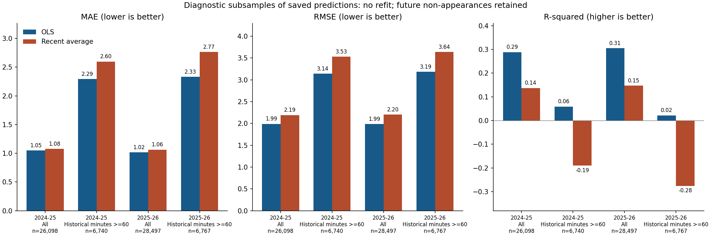
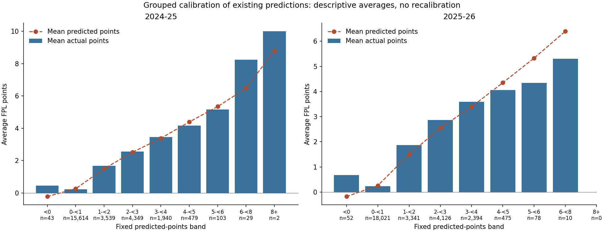

# Additional OLS evaluation diagnostics

These analyses describe the existing 54,595 saved predictions. They do not fit, tune or recalibrate any model. The original model, protocol, coefficients and historical results are unchanged.

## Accuracy conditional on high historical minutes

High minutes means `recent_minutes >= 60`: the existing pre-deadline mean minutes across up to three observed prior Gameweeks. The threshold is a fixed descriptive choice, not selected by testing alternatives. It includes short windows and summed DGW legs; it is not a per-match minutes measure or a guarantee of an upcoming start. All future non-appearances remain in this cohort.

| Season | Sample | Model | n | MAE | RMSE | R² |
| --- | --- | --- | ---: | ---: | ---: | ---: |
| 2024-25 | all | OLS | 26,098 | 1.0494 | 1.9911 | 0.2888 |
| 2024-25 | all | Recent average | 26,098 | 1.0782 | 2.1931 | 0.1372 |
| 2024-25 | high historical minutes | OLS | 6,740 | 2.2929 | 3.1402 | 0.0589 |
| 2024-25 | high historical minutes | Recent average | 6,740 | 2.5974 | 3.5319 | -0.1905 |
| 2025-26 | all | OLS | 28,497 | 1.0172 | 1.9868 | 0.3055 |
| 2025-26 | all | Recent average | 28,497 | 1.0630 | 2.2015 | 0.1473 |
| 2025-26 | high historical minutes | OLS | 6,767 | 2.3334 | 3.1868 | 0.0217 |
| 2025-26 | high historical minutes | Recent average | 6,767 | 2.7650 | 3.6395 | -0.2761 |

These are conditional forecast-error statistics: MAE is average absolute error and RMSE gives large errors more weight. R² compares squared errors with this subsample's own mean outcome; restricting the sample changes both the residual sum of squares and outcome variance. Therefore R² across samples is not a clean comparison of model quality. Compare OLS and the baseline within the same sample. Higher errors here do not establish a causal effect of minutes.

## Average outcomes by predicted-points band

Bands are fixed before this diagnostic calculation: <0, [0,1), [1,2), [2,3), [3,4), [4,5), [5,6), [6,8), [8,infinity). Boundaries are lower-inclusive and upper-exclusive. Negative predictions are retained; empty bands have n=0 and undefined means, not zero points.

| Season | Predicted band | n | Mean predicted | Mean actual | Actual minus predicted |
| --- | --- | ---: | ---: | ---: | ---: |
| 2024-25 | <0 | 43 | -0.2143 | 0.4651 | 0.6794 |
| 2024-25 | 0-<1 | 15,614 | 0.2677 | 0.2392 | -0.0284 |
| 2024-25 | 1-<2 | 3,539 | 1.5034 | 1.6929 | 0.1894 |
| 2024-25 | 2-<3 | 4,349 | 2.5205 | 2.5650 | 0.0444 |
| 2024-25 | 3-<4 | 1,940 | 3.3863 | 3.4536 | 0.0673 |
| 2024-25 | 4-<5 | 479 | 4.3940 | 4.1754 | -0.2187 |
| 2024-25 | 5-<6 | 103 | 5.3459 | 5.1553 | -0.1906 |
| 2024-25 | 6-<8 | 29 | 6.4771 | 8.2414 | 1.7643 |
| 2024-25 | 8+ | 2 | 8.7995 | 10.0000 | 1.2005 |
| 2025-26 | <0 | 52 | -0.1779 | 0.6731 | 0.8510 |
| 2025-26 | 0-<1 | 18,021 | 0.2566 | 0.2376 | -0.0191 |
| 2025-26 | 1-<2 | 3,341 | 1.4998 | 1.8740 | 0.3742 |
| 2025-26 | 2-<3 | 4,126 | 2.5454 | 2.8706 | 0.3251 |
| 2025-26 | 3-<4 | 2,394 | 3.3925 | 3.5898 | 0.1973 |
| 2025-26 | 4-<5 | 475 | 4.3510 | 4.0611 | -0.2900 |
| 2025-26 | 5-<6 | 78 | 5.3301 | 4.3462 | -0.9840 |
| 2025-26 | 6-<8 | 10 | 6.3993 | 5.3000 | -1.0993 |
| 2025-26 | 8+ | 0 | n/a | n/a | n/a |

This is a grouped calibration check: in a well-calibrated forecast, mean actual points should be close to mean predicted points within each band. A positive gap means underprediction on average; a negative gap means overprediction. A rising actual-points profile shows discrimination (sorting ability), which can coexist with imperfect calibration. Compare with each band's mean prediction, not its midpoint. These are sample averages, not fitted adjustments, causal effects or confidence intervals. Sparse tail bands are especially uncertain; repeated players and shared matches make observations dependent.

Both seasons remain retrospective comparisons, with the original coverage and publication-vintage limitations. These diagnostics do not make either season an untouched holdout. CSV files retain full precision; the manifest records the input prediction file's hash.
