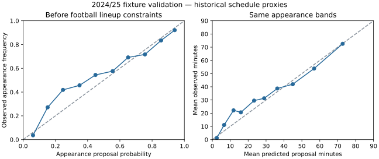
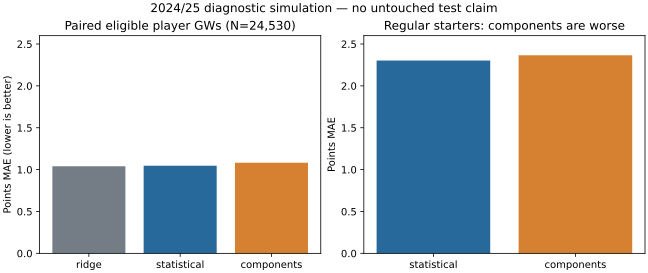

# Phase 4: fixture components in the Private Assistant

`fixture-components-v1` is a working, opt-in six-Gameweek simulator adapter. Statistical remains
the default. The existing Ridge remains a marginal-points comparison; it is not used for
captaincy/autosub optimisation. No public scenario behaviour or public recommendations changed.

## Historical evidence and feature contract

A bounded [Wayback CDX query](https://web.archive.org/cdx/search/cdx?url=fantasy.premierleague.com/api/fixtures/&output=json&filter=statuscode:200&from=202308&to=202505&collapse=timestamp:8&limit=120)
returned five daily-collapsed official fixture captures. Three small payloads (1.46 MB total)
were recovered and hashed in [fixture4-source-review.json](../fixture4-source-review.json).
Two retrievals failed; this was not an exhaustive archive search. Other inspected mirrors were
created during 2026, or documented bootstrap-only historical backfills.

Only [30 September 2023, 07:04:21 UTC](https://web.archive.org/web/20230930070421id_/https://fantasy.premierleague.com/api/fixtures/)
qualified within 24 hours before a target deadline (2023/24 GW7). The May 2024 capture was
after the season; February 2025's recovered capture was too old at the next deadline. The
failed 13 February 2025 retrieval remains an unresolved possible source.

| Fitting season | Verified schedule GWs | Retrospective proxy GWs | Eligible player-fixture rows |
| --- | ---: | ---: | ---: |
| 2023/24 | 1 | 37 | 27,112 |
| 2024/25 | 0 | 38 | 24,887 |

Thus **75/76 fitting Gameweeks use explicitly labelled final-schedule proxies**. GW1–3 have
no eligible player training rows under the three-prior-fixture minimum. Only 2023/24+2024/25
are fitted: 51,999 player-fixture and 1,520 team-fixture examples. 2025/26 is not evaluated or
used for selection. A verified schedule does not verify historic player registration, availability
or the original publication/revision time of preceding results. This is not strict point-in-time
historical validation. The earlier v1/v2 safe schemas remain unchanged; the new 29-column
component schema expressly accepts this research limitation.

Both historical and live processing use `assistant/component_features.py`: last-five/ten-match
minutes, last-five starts/appearance/sustained-start rates, last-ten xG/xA/goals/assists/saves/cards
per 90, position, history coverage, smoothed own/opponent scoring/conceding, home/away,
published fixture count, league rest and seven-day congestion. Team priors use five league-average
matches. No summed player xG is represented as authoritative team xG. Cup/international rest
is unavailable. Missing contributing statistics remain null, including a missing minutes denominator;
real zeros are retained. Imputation/scaling are fitted on the training partition only.

Histories must be from the same season, an earlier GW and a completed fixture whose kickoff
plus 24 hours is strictly before the cutoff. Same-GW double legs never become features for the
other leg. Team IDs are scoped by season. Conflicting verified archived assignments are excluded,
never silently moved to their final GW. Last-observed-club mismatches and fewer than three eligible
fixtures are excluded from fitting. All 38 Ferguson 2024/25 rows remain quarantined; original
source values are preserved. Prices, source xP, outcomes, end-season totals and quality metadata
are not predictors. Historical match position/roster membership are explicitly unverified proxies.

## What is learned and how it is simulated

One fixed configuration, two CPU threads, no parameter search:

| Component | Fitted method | Simulator use |
| --- | --- | --- |
| DNP / cameo / start under 60 / start 60+ | Four-state regularised logistic regression | Starter/cameo proposals |
| Conditional minutes for three appearance states | Ridge, five fitted residual quantiles | Bounded minute-window proposals |
| Team full-match goals | Regularised Poisson regression, own/opponent/fixture inputs | One shared team score process |
| Player goals and assists per 90 | Exposure-weighted Poisson regression, player/position inputs | Relative on-pitch allocation weights for the shared team events |
| GK saves and yellow cards | Exposure-weighted Poisson regression | Existing scorer's exposure-dependent events |
| Clean sheets | Derived from shared conceded-goal timings and actual simulated windows | Existing 60-minute/position rules |

Player attack rates are **allocation weights**, not independent goal/assist counts added on top
of team scores. Team/opponent context acts through shared scoring and playing-time proposals.
The simulator enforces its existing one-GK/eleven-player/five-sub constraints; realised appearance
probabilities differ from classifier proposals. Goals, assists and clean sheets are not double-counted.
Captain/vice, legal autosubs, bench order, transfer hits, Bench Boost and Triple Captain use the
same outcome samples and existing scoring/optimisation code for either selected simulator.

Statistical fallbacks remain for bonus competition, defensive contributions, untrained rare events,
cold starts, transfer/history conflicts, fewer than 90 observed minutes in the last ten eligible
fixtures, and missing/short team histories. The exposure guard prevents a two-minute goal from
turning an unstable per-90 rate into a near-certain starter; it also applies to zero-minute histories.
Training retains those source outcome rows, while runtime player components fall back. Current injury/chance
flags retain the statistical playing-time adjustment; no retrospective injury labels are invented.
Simple validation-only deviance/Brier gates can disable weak learned components; this fitted version
passes all gates. These gates do not establish full simulator calibration. Zero-minute disciplinary
events are scored correctly when present, but their future occurrence is not trained. Penalties,
own goals, red cards, set-piece roles and joint rotation are not comprehensively learned.

## Chronological diagnostic results

Initial fitting: 2023/24. Validation: 2024/25. Deployment refit: both earlier seasons after the
fixed component gates. The 2025/26 holdout was previously consumed and is not reused here.
Below are **development-model** diagnostics, not in-sample results from the deployment refit.

| Fixture proposal metric | Learned | Simple preceding-history baseline |
| --- | ---: | ---: |
| Appearance Brier | 0.10960 | 0.13248 |
| Appearance log loss | 0.35612 | 0.43892 |
| Minutes MAE | 15.610 | 13.559 |
| Minutes RMSE | 24.623 | 25.020 |
| Team-goal Poisson deviance | 1.11595 | 1.13033 |
| Team-zero-goal Brier (opponent CS proxy) | 0.17466 | 0.17667 |

Conditional-on-**observed**-minutes deviance: goals 0.40256 vs 0.46677; assists 0.40434 vs
0.45876; saves 1.37093 vs 2.25878; yellow cards 0.52672 vs 1.92293. These are retrospective
component diagnostics, not deployable predictions. Proposal minutes MAE is worse than a recent
average and intermediate appearance bands underpredict. Regular-starter proposal minutes MAE
is 21.619 (N=5,678).



Joint simulation uses the same buffered histories, 32 draws/GW and retrospective 2024/25 roster/
schedule proxies. The historical diagnostic scorer removes the newer defensive-contribution award.
Both methods keep the same approximate bonus/rare-event machinery. Published historic availability
is absent, so this **does not establish fair superiority over historic production forecasts**.
The frozen Phase 2b Ridge validation predictions are joined by player/GW, with identical targets
verified; their different feature schema is retained. All three rows below use the same 24,530 GWs.

| Method | Points MAE | RMSE | Bias (prediction − actual) |
| --- | ---: | ---: | ---: |
| Frozen chronological Ridge | **1.04047** | **1.97460** | +0.03108 |
| Statistical proxy replay | 1.04648 | 2.03690 | −0.08626 |
| Fixture components + exposure fallback | 1.08252 | 2.05790 | −0.06619 |

The final exposure-guarded implementation is **worse**, not an improvement over Ridge or the
statistical proxy. Its equal-GW paired bootstrap MAE difference (components minus statistical)
is +0.026 to +0.047 (95%, 2,000 resamples). This interval does not include schedule bias,
scoring-regime drift, Monte Carlo seed variation or model-selection uncertainty. Regular starters
(preceding starts≥80%, minutes≥60, N=5,596) worsen: MAE 2.36596 vs statistical 2.30287; RMSE
3.21100 vs 3.14591. Actual appearances worsen to MAE 2.00287 vs 1.96137; actual nonappearances
worsen to 0.40637 vs 0.37434 (both retrospective diagnostic groups). An initial unguarded prototype
had MAE 1.02323, but produced an implausible live sparse-minute prediction and was rejected.
The guard was added from that operational defect, not tuned to improve validation scores.
There is no further parameter search. Keep the statistical default; fixture ML is an experimental
comparison/planning option, not a recommended accuracy upgrade.

| Position diagnostic | N | Statistical MAE | Component MAE |
| --- | ---: | ---: | ---: |
| GK | 2,581 | 0.72479 | 0.76032 |
| DEF | 8,219 | 1.08029 | 1.11413 |
| MID | 11,042 | 1.05853 | 1.10480 |
| FWD | 2,688 | 1.20251 | 1.20374 |

Realised GW appearance Brier worsens 0.12449→0.12621; minutes MAE is 16.364 vs statistical
15.895, and bias −2.178 vs −2.340. The rollout remains frozen at today's observed form;
it does not simulate unknown future training histories, injuries, transfers or recovery. Published
opponents/venue/count/rest vary across the horizon. Doubles aggregate actual independent fixture
draws within each shared GW; blanks are zero only with complete confirmed schedule coverage.



## Operation, replay and deployment

Scientific fitting uses the existing isolated pinned environment. Production loads the committed
40 KB portable JSON with the standard library; no sklearn/LightGBM runtime, model download,
paid infrastructure or credentials are added. Config, data/source/code hashes and package versions
are embedded. Timings are stored separately so repeated fixed fitting produces stable model bytes.
The final fit took 47 seconds; the guarded joint diagnostic took 190 seconds during concurrent
checks. Each run uses the same fixed configuration and 32 draws/GW; no tuning search occurs.

```powershell
$env:PYTHONPATH='src'
ml/.venv/Scripts/python.exe -m ml.fetch_fixture_snapshots
ml/.venv/Scripts/python.exe -m ml.train_fixture_model
ml/.venv/Scripts/python.exe -m ml.validate_fixture_model
ml/.venv/Scripts/python.exe -m ml.plot_fixture_validation
ml/.venv/Scripts/python.exe -m unittest ml.tests.test_component_training ml.tests.test_fixture_dataset -v
.venv/Scripts/python.exe -m unittest discover -s tests -v
.venv/Scripts/python.exe -m fpl_forfeit.assistant.prospective --archive-dir ml/artifacts/fixture-components-v1/live-recording
.venv/Scripts/python.exe -m fpl_forfeit.assistant.prospective --replay PATH_TO_CAPTURE.json.gz
python -m ml.recording evaluate
```

Base preparation must already exist (`ml.prepare run`); frozen Ridge comparison requires existing
`baselines-v1/validation_predictions.parquet`, otherwise it is honestly omitted. Raw data, prepared
Parquet, full diagnostics and local captures stay ignored. The archived snapshot fetch verifies
pinned bytes and stops if unavailable; it does not substitute a later replay. Linux uses the
corresponding `bin/python` paths. Training/proposals are reproducible; upstream FPL revisions and
future live inputs intentionally change new captures.

In Predictions choose Statistical, Ridge, Fixture ML or either difference. Hover for per-fixture
coverage/fallbacks, or open a player for the full list and simulated components. The separate
Planning model selector controls XI/captaincy, transfers and chips; it defaults to Statistical.
Selection is request-local, protected by existing auth, with distinct planning caches. If fixture
ML is loading/fails, planning returns an explicit unavailable response; selecting Statistical works.
Ridge XI comparisons remain clearly unmultiplied marginal subtotals and are never optimised.

Verified 2026-10-14 official-input run: 667 players, 60 fixtures, GW7–12; 315 players have learned
player components in each GW; 352 use player fallbacks, primarily sparse exposure. Component
inference/simulation took 42.7 seconds during concurrent validation/tests after histories were collected.
The 1.2 MB original capture replayed **all three**
methods offline, including fixture projections. No partial/unknown schedule rows occurred in this
snapshot; synthetic tests cover them. This is a functional check, not future accuracy evidence.

New captures include component predictions, fixture projections, coverage/fallbacks, the exact
portable model, hashes and timestamps. Release validation checks the payload/prediction hashes;
the evaluator adds an identical-cutoff three-method paired group only when new fields exist.
The original statistical/Ridge groups and stage selection are unchanged. Existing immutable
captures (including GW7 advance) are never upgraded or reconstructed. The next eligible fresh
GW7 update/final captures can include the new model. No settings/secrets are added: the existing
hourly GitHub Actions runner and immutable Releases remain the durable store; Render files remain
ephemeral. Existing retention/bounds/recovery policy is unchanged. See
[PROSPECTIVE_RECORDING.md](PROSPECTIVE_RECORDING.md).

Highest-priority next work: accumulate untouched prospective results and calibrate **realised**
minutes/returns for regular starters and GK before changing defaults. Recovering more verified
historic schedules/registration and learning modern defensive actions/bonus are also unresolved.
No further tuning or next-phase experiment is automatically started.

Verification: 306 application tests and 40 focused ML tests passed; changed-file lint, production
frontend build and Private Assistant desktop/mobile/light/dark browser checks passed. A repository-wide
lint scan still reports 54 pre-existing findings in earlier ML files, outside this change.
